<div align="center">


# Território Vivo

**Painel mobile de inteligência territorial que antecipa problemas do bairro com alertas explicáveis, e deixa a decisão final com o gestor público.**

</div>

---

## 1. Problema e público

**Problema:** gestores públicos descobrem tarde o desperdício de água e energia, o acúmulo de resíduos, o calor extremo e as chuvas fortes que afetam a qualidade de vida de um bairro. Moradores, por sua vez, não têm um canal simples para relatar problemas.

**Território escolhido:** Bela Vista, São Paulo (SP).

**Para quem:** gestores públicos (acompanham indicadores, previsões e alertas) e cidadãos (registram ocorrências anônimas).

**Impacto social esperado:** agir antes do problema crescer, reduzindo desperdício de água, risco de alagamento e exposição ao calor, e dar voz à comunidade. O app exibe indicadores de benefício social (água potencialmente poupável, alertas com ação humana e ocorrências cidadãs).

## 2. Integrantes

| Nome completo | RM |
|---|---|
| Manoella dos Santos Ginez | RM564469 |
| Leonardo de Magalhães Piassa | RM563663 |    

## 3. Demonstração visual

| Consentimento | Visão geral | Painel Recursos |
|---|---|---|
| 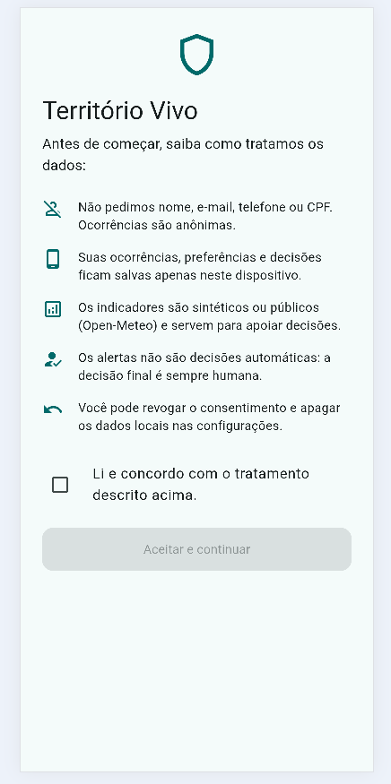 | 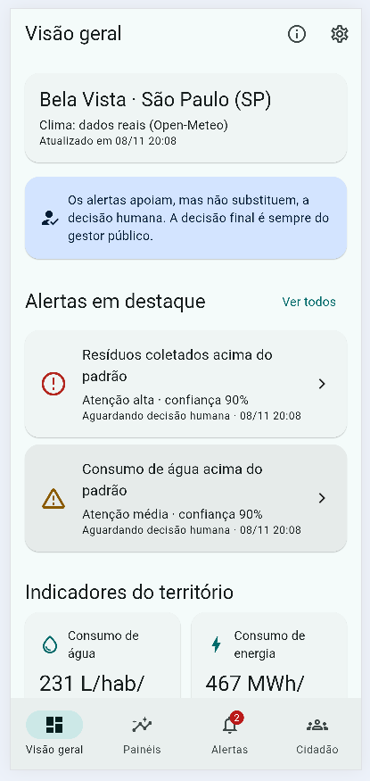 | 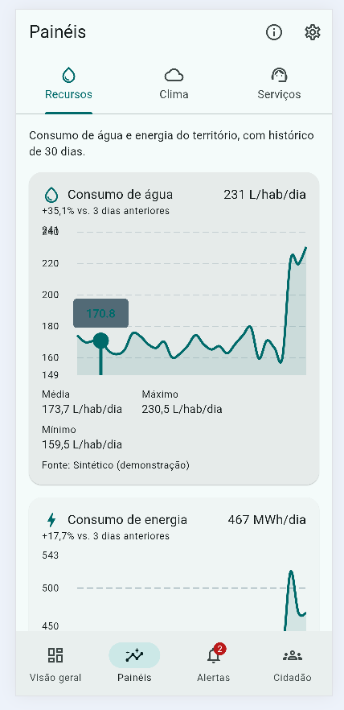 |
| Tela de consentimento e privacidade | Indicadores, alertas e benefício social | Água e energia com histórico e tendência |

| Painel Clima | Painel Serviços | Lista de alertas |
|---|---|---|
| 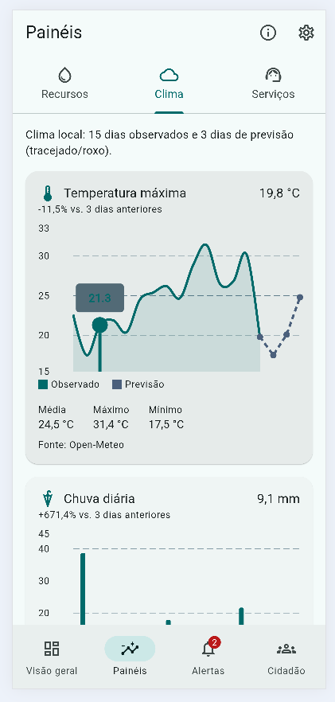 | 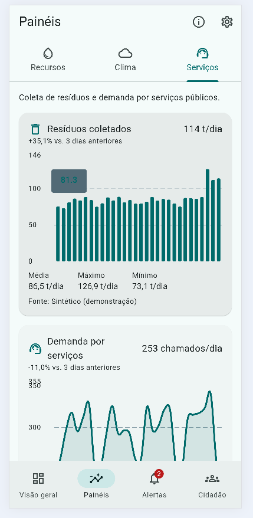 | 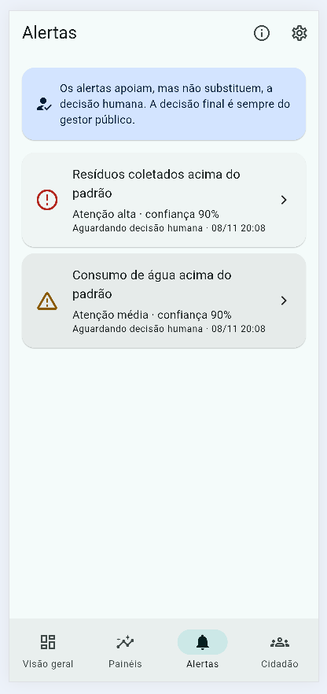 |
| Clima real com previsão | Resíduos e demanda por serviços | Alertas ordenados por severidade |

| Detalhe do alerta | Detalhe do indicador | Aba Cidadão |
|---|---|---|
| 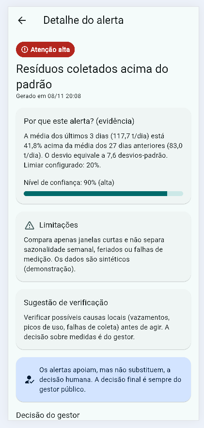 | 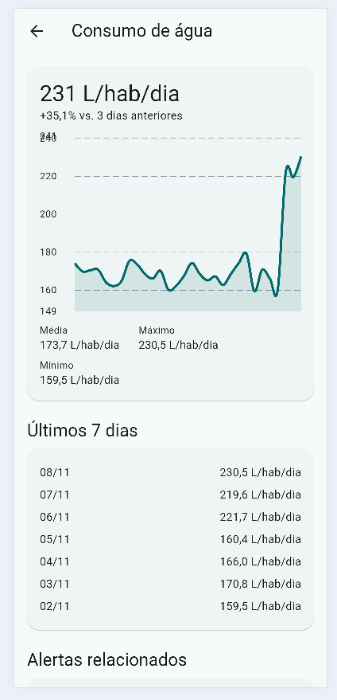 | 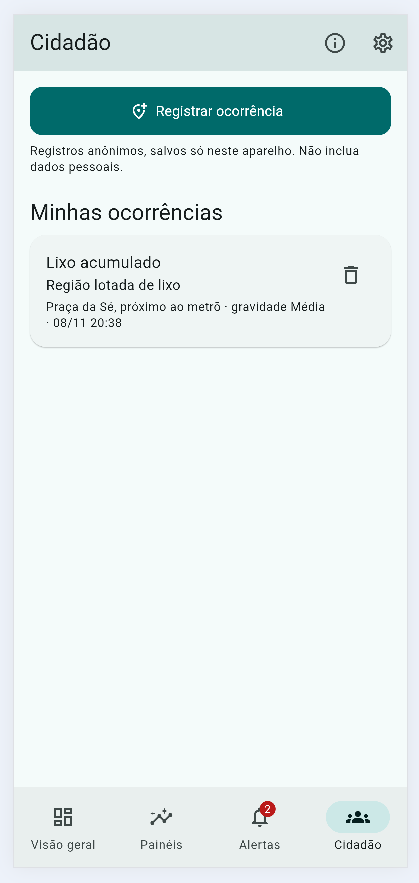 |
| Evidência, confiança, limitações e decisão humana | Gráfico, estatísticas e alertas relacionados | Ocorrências anônimas registradas |

| Formulário | Configurações | Sobre os dados |
|---|---|---|
| 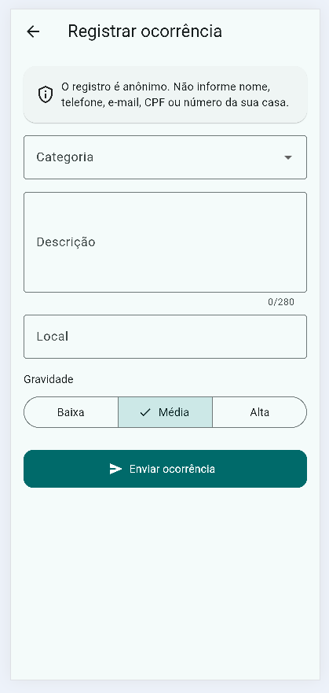 | 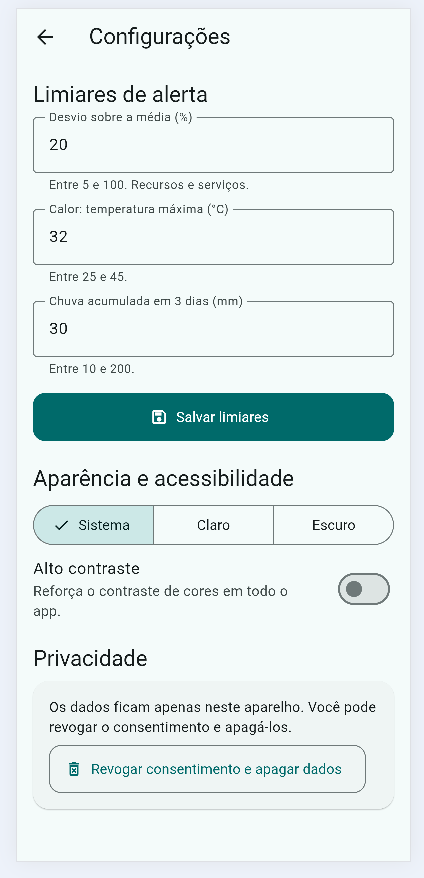 | 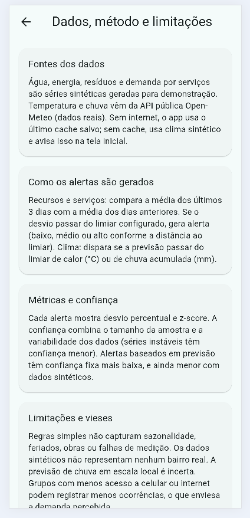 |
| Registro de ocorrência com validação | Limiares, tema e alto contraste | Método, vieses e limitações |

| Modo escuro | Estado de erro/vazio |
|---|---|
| 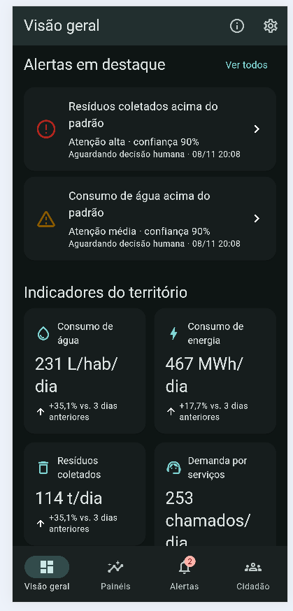 | 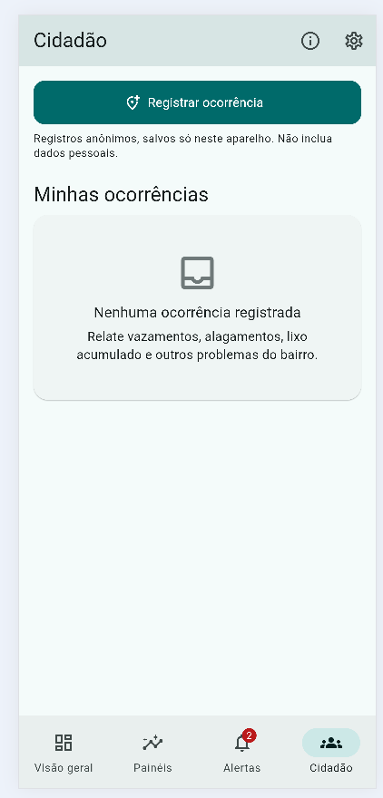 |
| Tema escuro | Lista vazia e tratamento de erro |

## 4. Funcionalidades

- [x] 8 rotas nomeadas com parâmetros (visão geral → indicador → alerta)
- [x] 3 painéis distintos (Recursos, Clima, Serviços) com gráficos, histórico e tendência
- [x] Alertas por regras estatísticas com justificativa, confiança e limitações
- [x] Aviso visível de que a decisão final é humana + registro da decisão do gestor
- [x] Estado global (Provider) compartilhado entre telas, com carregamento, erro e lista vazia
- [x] API real (Open-Meteo) e API simulada, com cache local e modo offline
- [x] Persistência local: ocorrências, decisões, limiares, tema e consentimento
- [x] Formulários com validação (ocorrência e limiares)
- [x] Indicadores de benefício social
- [x] Acessibilidade, consentimento e anonimização
- [x] Modo escuro e alto contraste
- [x] Testes automatizados da lógica de alertas e das validações
- [x] APK de release nas Releases do GitHub

## 5. Dados e alertas

**Fontes:** (a) séries sintéticas de água, energia, resíduos e demanda por serviços, geradas com seed fixa e servidas por uma API simulada (com latência); (b) dados reais de temperatura máxima e chuva da API pública [Open-Meteo](https://open-meteo.com) (sem chave de API).

**Como os alertas são gerados**
- *Recursos e serviços:* média dos últimos 3 dias contra a média dos dias anteriores. Se o desvio passar do limiar (padrão 20%), há alerta. Severidade: baixa, média (≥1,5× limiar) ou alta (≥2× limiar).
- *Clima:* alerta de calor se a previsão máxima passar do limiar (padrão 32 °C); alerta de chuva se a previsão acumulada de 3 dias passar do limiar (padrão 30 mm).

**Métricas:** desvio percentual, z-score, tamanho da amostra e coeficiente de variação. A **confiança** combina amostra e estabilidade dos dados; alertas de previsão têm confiança fixa mais baixa (calor 65%, chuva 55%), reduzida em 15 pontos com dados sintéticos.

**Limitações e vieses**
- Regras simples não capturam sazonalidade, feriados, obras ou falhas de medição.
- Dados sintéticos não representam um bairro real.
- Chuva em escala local é difícil de prever.
- Quem tem menos acesso a celular ou internet registra menos ocorrências.

**Quando as previsões não são confiáveis:** com menos de 7 dias de dados (nenhum alerta é gerado), com confiança baixa, com fonte sintética, com clima vindo de cache antigo e após eventos atípicos.

**Benefício social (estimativas):** "água potencialmente poupável" usa uma população sintética de 25.000 habitantes; os demais indicadores contam ações humanas e ocorrências.

## 6. Privacidade e inclusão

- Tela de consentimento obrigatória, com possibilidade de revogar e apagar os dados locais.
- Nenhum dado pessoal é coletado: o formulário bloqueia e-mail, telefone e CPF em texto livre.
- Todos os dados ficam apenas no aparelho (SharedPreferences). Nenhuma chave de API é usada.
- Acessibilidade: `Semantics` em gráficos, cartões e botões; severidade comunicada por cor, ícone e texto; áreas de toque ≥ 48 dp; suporte a fonte ampliada (layout em 1 coluna quando a fonte é grande); tema escuro e de alto contraste; interface em português do Brasil.

## 7. Tecnologias e decisões técnicas

| Escolha | Justificativa |
|---|---|
| Flutter + Material 3 | Um código para Android e iOS, com componentes acessíveis |
| `provider` | Simples e suficiente para estado global (território, ocorrências, preferências) |
| `go_router` | Rotas nomeadas, parâmetros por URL e redirecionamento por consentimento |
| `http` | Consumo da API Open-Meteo |
| `shared_preferences` | Persistência leve de preferências, ocorrências, decisões e cache |
| `fl_chart` | Gráficos de linha e barras com previsão tracejada |
| Open-Meteo | Dados reais gratuitos e sem chave (nada sensível no repositório) |
| Motor de alertas em Dart puro | Regras explicáveis e testáveis, sem caixa-preta |

**Arquitetura:** `core/` (tema, rotas, validações), `data/` (modelos, serviços, repositório, motor de alertas), `state/` (providers), `screens/` e `widgets/` (UI reutilizável).

## 8. Como executar

```bash
git clone https://github.com/manoellaginez/territorio-vivo.git
cd territorio-vivo
flutter pub get
flutter run            # emulador ou dispositivo conectado
flutter run -d chrome  # executar no chrome
flutter test           # testes automatizados
flutter build apk --release
```

Não há variáveis de ambiente nem chaves de API para configurar.

## 9. Vídeo

[Assista à demonstração](https://youtu.be/qIidRzh9iSk?is=8nWfgRSnAbze01ju)

## 10. Licença

Projeto acadêmico, FIAP, Global Solution 2026.2.